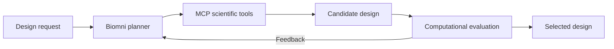

<div align="center">

# BioSyn-Agent

### Biological design through language, scientific tools and feedback

[Interactive demo](https://zhymlumine.github.io/biosyn-agent-demo/) · [Quick start](#quick-start) · [MCP tools](docs/tools.md) · [Task guide](docs/tasks.md)

</div>

BioSyn-Agent turns natural-language design goals into biological design artifacts. Built on [Biomni](https://github.com/snap-stanford/biomni), it connects an LLM planner to scientific tools, records candidate designs, evaluates their properties and uses the feedback to guide revisions.

The framework supports genetic circuits, bacterial regulatory sequences, human RNA design and metabolic pathways. DNA, RNA and protein tools connect through the Model Context Protocol (MCP), while OpenBioMed workflows and Markdown skills provide additional capabilities.

## Highlights

- **Design with explicit objectives.** Combine a natural-language request with measurable objectives, constraints and a tool budget.
- **Keep the design connected.** Track DNA, RNA, protein sequences and associated artifacts in a shared candidate state.
- **Close the computational loop.** Evaluate candidates, inspect constraint violations, revise designs and select a final artifact.
- **Extend through MCP.** Connect local workers or HTTP services, including foundation models in separate environments.
- **Inspect the process.** Save candidate histories, tool calls, evaluation reports and the selected design.



## Quick start

Use Python 3.12 and Git. Run the following commands from the repository root:

```bash
python3.12 -m venv .venv-biomni
source .venv-biomni/bin/activate
python -m pip install --upgrade pip

python scripts/prepare_biomni.py
python -m pip install -e ./Biomni -e '.[test,comparison]'
```

`prepare_biomni.py` sets up the compatible Biomni revision and applies the execution patch in `patches/`. Scientific model workers can use their own Python environments.

### 1. Try a scientific tool

The default CPU configuration starts DNA sequence tools and ViennaRNA folding through MCP:

```bash
biosyn catalog \
  --config configs/biomni/cpu.yaml \
  --run-dir runs/tool-catalog

biosyn tool \
  --config configs/biomni/cpu.yaml \
  --run-dir runs/rna-fold \
  rna.rnafold --args '{"rna":"GGGAAACCC"}'
```

### 2. Configure the language model

```bash
cp .env.example .env
```

For an OpenAI-compatible local service, set `BIOSYN_LLM_API_KEY` in `.env` and edit the model name and endpoint in [`configs/biomni/local.yaml`](configs/biomni/local.yaml):

```yaml
llm:
  model: glm-5.3-flash
  base_url: http://127.0.0.1:8000/v1
  api_key_env: BIOSYN_LLM_API_KEY
  temperature: 0.2
  max_tokens: 8192
  timeout: null
```

For DeepSeek, set `DEEPSEEK_API_KEY` and use [`configs/biomni/deepseek.yaml`](configs/biomni/deepseek.yaml). Configurations specify the LLM, enabled MCP servers, skills and execution budgets.

### 3. Run a design task

The sequence example asks the agent to design a complete CDS for a short peptide while satisfying GC and RNA folding constraints:

```bash
biosyn --env-file .env run \
  --config configs/biomni/local.yaml \
  --task examples/tasks/cds_design.json \
  --run-dir runs/sequence-design
```

Use a new output directory for each run. The output includes:

| File | Contents |
|---|---|
| `best-design.json` | Selected candidate and sequence fields |
| `best-design.fasta` | Selected DNA, RNA and protein sequences |
| `report.json` | Task, candidates, evaluations and final status |
| `events.jsonl` | Tool calls and design events |
| `conversation-*.json` | Planner conversation for each round |

The CLI also supports `biosyn evaluate` for evaluating supplied candidates and `biosyn export-biodesignbench` for exporting a run in BioDesignBench's agent-output format.

## Python API

```python
from pathlib import Path
from dotenv import load_dotenv

from biosyn.agent.runtime import DesignRuntime
from biosyn.agent.state import TaskSpec
from biosyn.config import load_config

load_dotenv()
task = TaskSpec.model_validate_json(
    Path("examples/tasks/cds_design.json").read_text()
)
config = load_config(Path("configs/biomni/local.yaml"))
state = DesignRuntime(task, config, Path("runs/python-design")).run()
print(state.status, state.best_id)
```

See [`examples/run_design.py`](examples/run_design.py) for a command-line version.

## Design applications

| Application | Design artifact | Computational tools |
|---|---|---|
| Genetic circuits | Regulatory connections and assembled DNA | Cello gate models, Boolean logic and response separation |
| Bacterial RBS design | Shine–Dalgarno sequence in a fixed gene context | EMOPEC, ViennaRNA and OSTIR |
| Human 5′UTR design | UTR sequence in a fixed transcript context | Optimus5Prime, RiboNN and Saluki |
| Metabolic pathways | Reaction, enzyme and support-gene choices | COBRA flux-balance analysis with host reconstructions |

The [interactive demo](https://zhymlumine.github.io/biosyn-agent-demo/) presents recorded examples from all four applications. Application evaluators load their scientific resources from a separate resource directory. The [application guide](docs/applications.md) describes the task interface, resource layout and execution entrypoints.

## Tools and workflows

| Integration | Available operations |
|---|---|
| DNA utilities | Sequence statistics, transcription and CDS translation |
| RNA utilities | RNAfold structure prediction |
| Evo2 | DNA generation and sequence log-likelihood |
| Nucleotide Transformer | Sequence embeddings and configured prediction heads |
| RNA-FM | RNA sequence embeddings |
| protein-design-mcp | Protein tools exposed by the upstream MCP server |
| OpenBioMed | Discover and execute configured workflows |

Enable extensions in [`configs/biomni/extensions.example.yaml`](configs/biomni/extensions.example.yaml). Each model service uses a deployment manifest specifying its checkpoint, revision and device. See the [MCP tool guide](docs/tools.md) for configuration examples and the [OpenBioMed guide](docs/openbiomed.md) for workflow integration.

Add workflow guidance as Markdown files under `examples/skills/` and list them in the configuration's `skills` field. Biomni retrieves these documents alongside the enabled tools.

## Project structure

```text
src/biosyn/
├── agent/          Planner, candidate state, evaluation and selection
├── mcp/            MCP client and scientific model services
├── applications/   Application evaluators and episode execution
├── integrations/   OpenBioMed, protein tools and BioDesignBench
└── benchmarks/     Benchmark contracts and execution utilities
configs/            LLM and tool-service configurations
examples/           Design requests, Python usage and skills
scripts/            Dependency setup and repository checks
patches/            Biomni execution support
tests/biomni/      Framework and transport tests
docs/              Task, tool and application guides
```

## Development

```bash
make check
make test
```

Tests cover sequence consistency, scoring, MCP transports, candidate submission, feedback control and planner execution. GitHub Actions runs the checks on Python 3.12.

To add a tool, expose a typed function through an MCP server and register the server in a configuration. To use its output as an objective, map the returned field in a task's `evaluators` section. The [task guide](docs/tasks.md) walks through this interface.

## License

BioSyn-Agent is licensed under [Apache-2.0](LICENSE).

## Acknowledgements

BioSyn-Agent builds on [Biomni](https://github.com/snap-stanford/biomni) and integrates [OpenBioMed](https://github.com/PharMolix/OpenBioMed), [protein-design-mcp](https://github.com/jasonkim8652/protein-design-mcp) and [BioDesignBench](https://github.com/RomeroLab/BioDesignBench). Scientific tools and model resources retain their upstream attribution and licenses.
